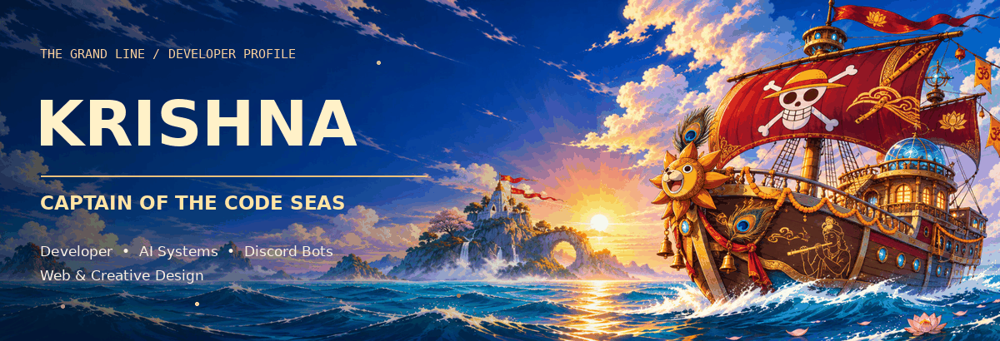
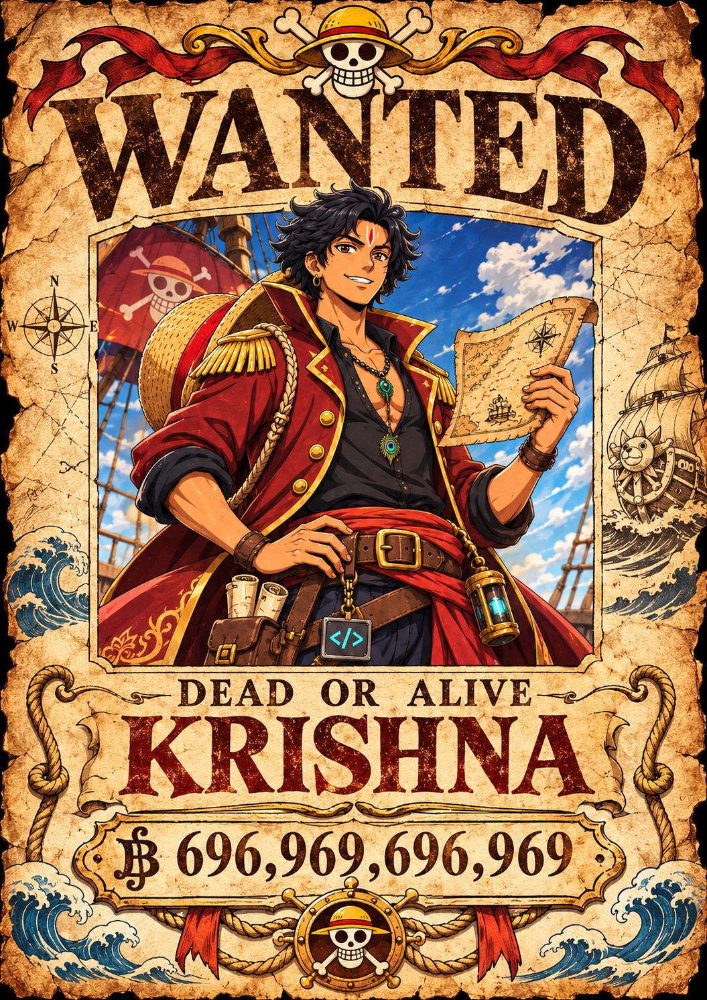
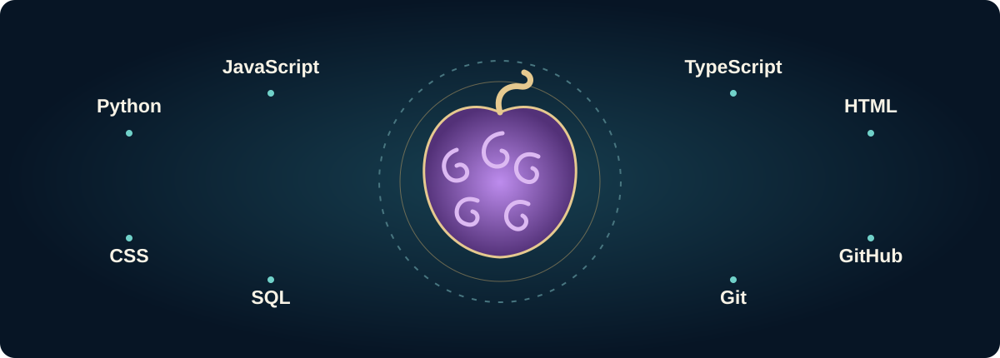
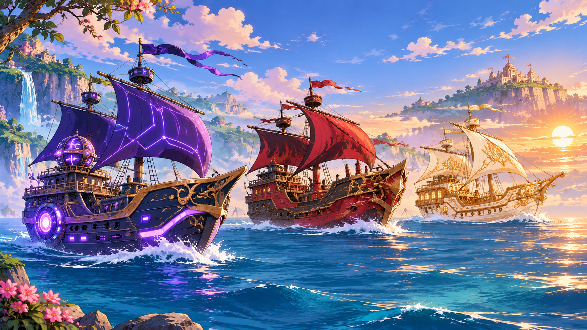
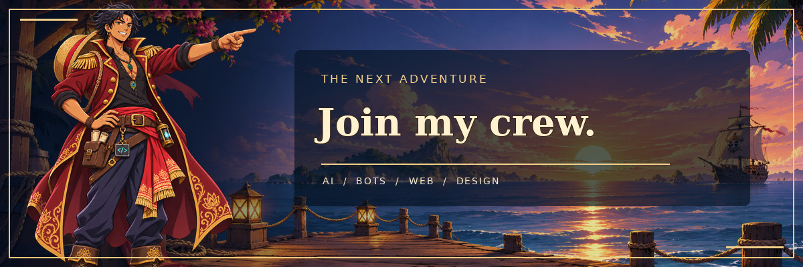

**Developer · AI systems · Discord bots · Web & creative design** 
BCA graduate · India

[Captain’s log](#captains-log) · [Bounty dashboard](#world-government-bounty-dashboard) · [Fleet](#pirate-fleet) · [Join my crew](#join-my-crew)

## Captain’s log

I’m **Krishna**, a BCA graduate from India building AI-powered systems, Discord bots, websites and creative digital experiences. I enjoy connecting practical automation with thoughtful interfaces, and designing cinematic gaming thumbnails with attention to composition, lighting and character detail.

My interests include programming, anime, gaming and AI integrations. Currently exploring AI orchestration, community tools and responsive web experiences.

## World Government bounty dashboard

The bounty is **fictional**. The public GitHub figures below come from this account’s latest successful refresh. Repository language counts describe primary languages of owned non-fork repositories; they are not a measure of proficiency.

<!-- ACTIVITY:START -->
Last successful refresh: **2026-11-01 23:37 UTC** · hourly + profile updates · public data only

**Public owned repositories:** 18 · **Stars on owned repositories:** 17 · **Contributions in GitHub's calendar period:** 901

| Recently pushed repository | Latest push · UTC |
| :--- | :--- |
| [porfolio-test-33](https://github.com/krishna3251/porfolio-test-33) | 2026-11-01 · 18:57 |
| [fruty](https://github.com/krishna3251/fruty) | 2026-10-29 · 09:49 |
| [sri-sai-nath-](https://github.com/krishna3251/sri-sai-nath-) | 2026-10-26 · 05:18 |
| [rule-34](https://github.com/krishna3251/rule-34) | 2026-10-20 · 15:01 |

**Primary languages across owned non-fork repositories:** Python: 6 · TypeScript: 6 · CSS: 3 · Dockerfile: 1
<!-- ACTIVITY:END -->

## Devil fruit tech system

**Code:** Python · JavaScript · TypeScript · HTML · CSS · SQL 
**Tools:** Git · GitHub 
**Interests:** AI and automation · Discord development · web development · creative design

## Pirate fleet

- **[Rukiya](https://github.com/rukia3287-jpg/rukiya)** — AI chatbot with orchestration and Discord / YouTube Live functionality.
- **[Lxeus](https://github.com/krishna3251/lexus_dc)** — Discord community bot with moderation, utilities and integrations.
- **[Web experiments](https://github.com/krishna3251/krish_pport)** — responsive interfaces, animated websites and modern web development.
- **[Server Builder](https://github.com/krishna3251/server-builder-bot)** — a Discord bot for building community setups.

## Grand line of contributions

The chart uses this account’s GitHub contribution calendar; the moving trail is decorative. The legend shows increasing activity, and the date range and total are printed on the chart. Data is refreshed hourly when the workflow succeeds.

## Join my crew

Have a bot idea, a web project, or a gaming thumbnail in mind?

**[GitHub](https://github.com/krishna3251)** · **[LinkedIn](https://www.linkedin.com/in/krishna-soni-a00910279/)** · **[Instagram](https://www.instagram.com/krishna_sanskari69/)** · **[Email](mailto:krishnasoni3251@gmail.com)**

<a href="docs/PROFILE.md">How this profile updates</a>
